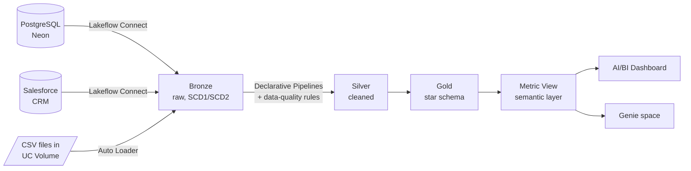

# RetailQ: Retail Analytics Lakehouse on Databricks

An end-to-end lakehouse that brings retail data from three different kinds of source (a PostgreSQL database, Salesforce CRM and CSV files in cloud storage) into Databricks. It cleans the data through a Bronze → Silver → Gold medallion architecture, defines business KPIs in a semantic layer, and serves them through an AI/BI dashboard and a Genie space. One Databricks Job orchestrates the whole flow.

Built on **Databricks Free Edition** (serverless) with Unity Catalog.

## Architecture



| Layer | Schema(s) | What happens there |
|---|---|---|
| Bronze | `postgres_bronze`, `salesforce_bronze`, `blob_bronze` | Raw copies of each source, loaded incrementally |
| Silver | `retail_silver` | Standardised columns, type casting, derived fields, data-quality expectations |
| Gold | `retail_gold` | Star schema: `fact_sales` plus customer, product and calendar dimensions |
| Semantic | `retail_semantic` | `retail_metrics` metric view: shared KPI definitions for the dashboard and Genie |

## Data sources and ingestion

| Source | Tables | Method | History |
|---|---|---|---|
| PostgreSQL (Neon) | `product_catalog` | Lakeflow Connect, timestamp cursor column | SCD Type 2 |
| PostgreSQL (Neon) | `inventory` | Lakeflow Connect, timestamp cursor column | SCD Type 1 |
| Salesforce | `account` | Lakeflow Connect (system timestamp tracked automatically) | SCD Type 2 |
| Salesforce | `opportunity` | Lakeflow Connect | SCD Type 1 |
| CSV in a UC managed volume | `transactions` | Auto Loader (`cloudFiles`), `availableNow` trigger | Append-only |

The Lakeflow Connect ingestion pipelines were configured in the Databricks UI, so they have no code files here. Auto Loader keeps a checkpoint of the files it has already processed, so a re-run loads only new files.

## Repository layout

```
notebooks/
  blob_to_bronze.py        Auto Loader: CSV files → blob_bronze.transactions
  Gold_views.sql           dim_customer, dim_product, fact_inventory views
  dim_calender.sql         calendar table (2025-01-01 to 2027-12-31)
  metric_view.sql          retail_semantic.retail_metrics (YAML metric view)
pipelines/                 Lakeflow Spark Declarative Pipeline source
  bronze_to_silver/        account, opportunity, product_catalog, inventory, transactions
  silver_to_gold/          fact_sales
dashboard/                 AI/BI dashboard export (.lvdash.json)
jobs/                      Retail_end_to_end job definition (YAML)
```

## Silver layer: data quality

Each Silver dataset declares expectations with `@dp.expect` (keep the row, record the failure) or `@dp.expect_or_drop` (remove the row):

| Dataset | Rules | Examples |
|---|---|---|
| `product_catalog` | 6 | product ID present, price not negative, name and category present |
| `transactions` | 6 | transaction ID present, quantity > 0, payment mode in an allowed list |
| `opportunity` | 5 | ID present, amount not negative, probability between 0 and 100 |
| `inventory` | 4 | inventory ID present, stock quantity > 0 |
| `account_scd` | 2 | ID present, customer name present |

Silver also adds derived columns, such as `deal_size` on opportunities and `inventory_status` (LOW_STOCK / HEALTHY) on inventory. `product_catalog` keeps only the current version of each product and de-duplicates on `product_id` with a window function.

## Gold, semantic layer and dashboard

- **`fact_sales`** joins transactions to Salesforce opportunities on a normalised opportunity name, which links each sale to its customer account.
- **`retail_metrics` metric view** defines 6 measures (transaction count, total revenue, quantity, discount, average transaction value, unique customers) and 15 dimensions across date, product, customer and channel, with synonyms so Genie can map natural-language questions to them.
- **Dashboard:** 5 KPI tiles and 9 charts (revenue trend, category mix, top products and brands, channel, payment mode, store and day-of-week performance).

## Orchestration

`jobs/Retail_end_to_end.yml` defines a 5-task Databricks Job:

```
ingest_salesforce_to_bronze → ingest_postgres_to_bronze → ingest_blob_to_bronze → Silver_and_gold → Dashboard_refresh
```

The job starts on **file arrival**: dropping a new CSV into the transactions volume triggers the full pipeline.

## Lesson learned: streaming tables vs CDC sources

The first end-to-end job run failed in Silver with `DELTA_SOURCE_TABLE_IGNORE_CHANGES`.

- **Cause:** Silver `account` was a streaming table (`spark.readStream`). Streaming reads expect an append-only source, but the Bronze table is maintained by Lakeflow Connect, which applies changes with `MERGE`. When the SCD Type 2 update rewrote existing rows, the stream stopped rather than guess how to apply it.
- **Fix:** changed the dataset to a materialized view (`@dp.materialized_view` with `spark.read`), which recomputes from the current state of Bronze and handles updates and deletes. `product_catalog` follows the same pattern.

## Next steps

- Convert `opportunity` and `inventory` to materialized views as well: their Bronze sources also receive `MERGE` commits from Lakeflow Connect.
- Point `dim_customer` at `account_scd` and drop the old `account` streaming table.
